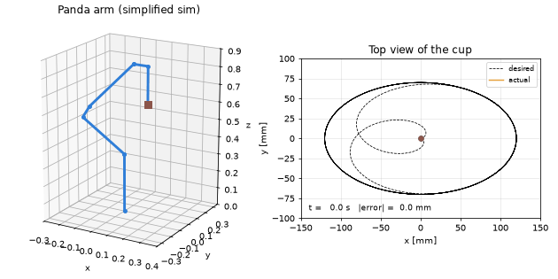
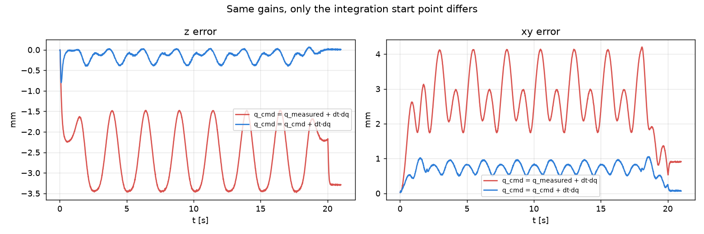
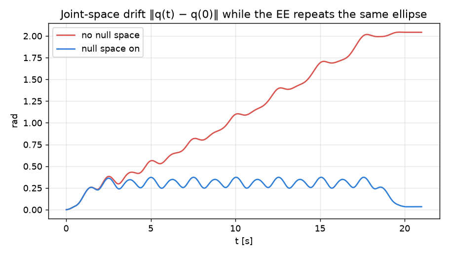
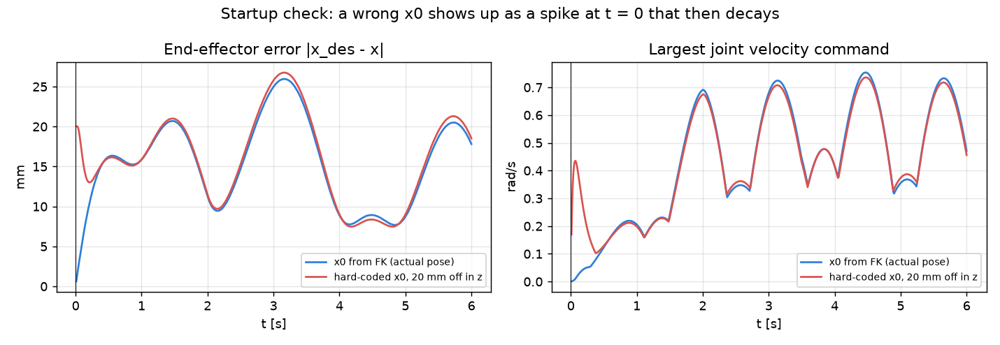

# Upright-Cup Mixing on a 7-DOF Panda — Differential IK with Null-Space Control
*By Changyu Wang · University of Pennsylvania*



A Franka Panda holds a cup and moves it along a horizontal ellipse (12 cm × 7 cm) while keeping it upright, so the ingredients mix without spilling. This is a self-contained re-implementation (numpy + matplotlib only) of the mixing module I worked on for the MEAM 5200 *Trail Mix Bar* final project, which was showcased on real Panda arms at Penn's GRASP Lab.

**Interactive 3D replay:** https://wangcy0928.github.io/panda-cup-mixing/

## Results

Same simulated plant and load for every run. Numbers come from `results/metrics.md`.

| controller | xy RMS error | mean z error (sag) | peak horizontal accel | max cup tilt † |
|---|---|---|---|---|
| v1: P-only, integrate from measured q | 12.3 mm | 16.2 mm | 2.6 m/s² | 27.6° |
| v3: course final controller | 13.7 mm | 0.8 mm | 2.7 m/s² | 31.9° |
| **v4: this repo** | **0.7 mm** | **0.15 mm** | **0.85 m/s²** | **0.06°** |

v3 is the final controller from the course (`3.py` in the course code, not included here). `results/metrics.md` also lists v2, which plans the whole path offline and replays it without feedback.


- **xy RMS error:** distance between the cup and the planned ellipse in the horizontal plane.
- **Mean z error (sag):** how far the cup hangs below the planned height.
- **Peak horizontal accel:** a proxy for spill risk.

The v1 → v3 step matches what we observed on the real robot: about 15–20 mm of sag, removed in v3 by a stronger z-gain and an integral term. v4 removes the sag differently, by integrating the command from its own state (see finding 1), and also tracks the ellipse much more closely.

† The large tilt for v1 and v3 comes from this model's soft wrist; on the real robot the cup did not visibly tilt. See Limitations.


## How it works

Every 10 ms (100 Hz) the controller reads the joint angles, works out the joint velocities that move the cup toward its planned position, and sends a new position command.

```
ellipse: x_des(t), v_des(t)
        │
        ▼
q (measured) → FK → x, R
        │
        ▼
v = v_des + K (x_des − x)         task-space feedback
ω = k_r · e_R(R_home, R)          keep the cup upright
        │
        ▼
dq = J⁺ [v; ω] + (I − J⁺J) · k_n (q_home − q)
     (damped least squares)   (null space: stop joint drift)
        │
        ▼
scale dq to the velocity limits
        │
        ▼
q_cmd ← q_cmd + dt · dq   ──►  robot  ──►  q (measured), next tick
```

- **Feedback and feed-forward.** The task velocity is the planned velocity plus a correction proportional to the position error. The orientation error has its own term that keeps the cup upright.
- **Differential IK.** J⁺ turns the 6-D task velocity into 7 joint velocities. Damped least squares keeps those velocities bounded near a singularity.
- **Null space.** The arm has 7 joints for a 6-D task, so some joint motion does not move the cup at all. The null-space term uses it to pull the joints back toward the start pose.
- **Velocity limits.** If any joint would exceed its limit, the whole velocity vector is scaled down, so the cup still moves in the planned direction.
- **Integration.** `q_cmd` keeps its own state between ticks instead of restarting from the measured pose (see finding 1).


## Improvements in v4

This is an ablation study: each row reverts one choice in v4 and leaves everything else
unchanged.

| reverted | what gets worse |
|---|---|
| Integrate from the measured pose instead of the previous command | mean z error 0.15 → 2.6 mm, xy error 0.74 → 2.9 mm |
| Task gains kp = kz = 1 instead of 8 | xy error 0.74 → 2.3 mm, z error 0.15 → 1.2 mm |
| Low-pass filter (α = 0.35) added back to the loop | xy error 0.74 → 2.1 mm |
| Abrupt stop instead of a 2 s smooth ramp-out | peak horizontal accel 0.85 → 2.6 m/s² |
| No null-space joint centering | joint 1 drifts 0.03 → 1.55 rad |
| Orientation gain k_r = 0.05 instead of 4 | max cup tilt 0.06° → 0.5° † |

† Tilt is exaggerated by the model's soft wrist, see Limitations.

Damped least squares is in v4 as a safeguard and is not in the table: on this path the arm stays far from a singularity (minimum manipulability 0.07 in v4, 0.05 in v3), so it barely
changes the results.




## Findings

### 1. Integrate from the command

Restarting the command from the measured pose every tick (`q_cmd = q_meas + dt·dq`) leaves the joint controller almost no position error to push against, so the load makes the arm sag. That is why the course version needed a large `kz` and an extra integrator. Integrating from the previous command lets the correction accumulate in the command itself, which acts like an
integral term and removes the sag with plain P gains.

### 2. Low gains and a filter

The course controller used kp = 1 in xy (and kz = 6 plus an integrator in z), and a low-pass filter (α = 0.35) that adds about 19 ms of lag. In the ablation, reverting either the gains (kp = kz = 1) or the filter raises v4's xy error roughly threefold. A singularity is not the cause: along this path the minimum manipulability is 0.05–0.07.

### 3. Null-space stops drift

With 7 joints for a 6-D task, joints 1 and 7 can counter-rotate without moving the cup. From this start pose the cup is only 0.145 m in front of the base axis, so joint 1 barely moves it and the pseudoinverse lets it wander: about 1.5 rad in 20 s, even on an ideal robot. The course code pulled only joint 1 back, which is enough for this pose. v4 pulls all joints back, so it also works from other poses.



### 4. Start from the actual pose

The cup arrives from the upstream module with some position error. If x0 is hard-coded, the controller sees that error at t = 0 and yanks the cup. Peak acceleration in the first second (along z, original gains) grows with the offset: 0.44 → 0.95 → 2.39 m/s² for 0 / 20 / 50 mm. After about 1 s the runs look the same, so this explains the startup jerk only. With v4's higher gains the same offsets are worse: 0.54 → 2.19 → 5.51 m/s².




## Limitations

- **v4 has only run in simulation.** `ros/mixing_v4.py` ports it to the course interface, and I
  checked that it runs end to end against a stand-in for that interface, but it has not been
  tested on the real robot.
- **The robot model is simplified.** `sim_robot.py` has decoupled joints, no inertia matrix and
  no Coriolis terms. The payload is an effective mass chosen so that the v1 controller sags
  15–20 mm, which is what we observed on the real robot. Nothing else is calibrated, so trends
  are more reliable than exact magnitudes.
- **Tilt is exaggerated.** The large tilt for v1 and v3 comes from this model's soft wrist; on
  the real robot the cup did not visibly tilt. The mechanism is still real, because k_r = 0.05
  provides almost no orientation correction.
- **v2 looks better than it was.** The simulation does not model the mechanical rattling that
  made the offline-replay version unusable on hardware.
- **No mixing-quality or spill model.** Peak horizontal acceleration is used as a proxy.
- **One start pose and one path.** Every result uses the same start pose and the same ellipse.


## Run it

```bash
pip install -r requirements.txt     # on macOS use pip3 / python3
python kinematics.py        # checks the analytic Jacobian against finite differences
python sim_robot.py         # payload sag of the simulated arm
python run_experiments.py   # all experiments: plots + results/metrics.md (~1–2 min)
python animate.py           # regenerates results/mixing.gif
python startup_check.py     # why x0 must come from FK (results/6_startup_x0_check.png)
python export_viewer.py     # 3D replay of v3 vs v4 -> docs/index.html
```

### ROS (course interface)

`ros/mixing_v4.py` is v4 written against the MEAM 5200 interface (`ArmController`, `lib.calculateFK`, `lib.calcJacobian`). The course `lib/` is not included, so copy `mixing_v4.py` (and `plot_log.py`) next to the course code and launch the simulation, then:

```bash
python3 mixing_v4.py                   # v4 (integrate from the command)
python3 mixing_v4.py --from-measured   # integrate from the measured pose, for comparison
python3 plot_log.py logs/*.csv         # metrics + comparison plot (no ROS needed)
```

The ROS version adds one safety bound: the command may lead the measured pose by at most 0.1 rad.


## Repository layout

| file | what it is |
|---|---|
| `kinematics.py` | Kinematic model of the Panda arm. It uses the DH parameters to compute the forward kinematics and the Jacobian, which connect joint space to end-effector space. |
| `sim_robot.py` | Simplified robot model: joint PD tracking, unmodelled payload, 1-tick delay, encoder noise |
| `controller.py` | The controller; each design choice is a flag in `Config` |
| `run_experiments.py` | History comparison and one-at-a-time ablations |
| `animate.py` | GIF of the v4 controller |
| `startup_check.py` | Hard-coded vs FK-based ellipse centre: startup error and joint-velocity spike |
| `export_viewer.py`, `viewer_template.html` | Runs v3 and v4 and writes `docs/index.html`, a 3D replay of both side by side |
| `ros/mixing_v4.py` | v4 on the MEAM 5200 ROS interface, with CSV logging (not yet tested in Gazebo or on hardware) |
| `ros/plot_log.py` | Metrics and plots from the CSV logs written by `mixing_v4.py` |


## Next steps

- Run `ros/mixing_v4.py` in the real robot.
- Port to MuJoCo with the full Panda model (mujoco_menagerie), using the same `Config` flags.
- Trajectory shaping: limit centripetal acceleration r·ω² and compare a figure-8 (Lissajous) stir with the ellipse.
- Measure mixing quality from images (colour distribution of two ingredients).
